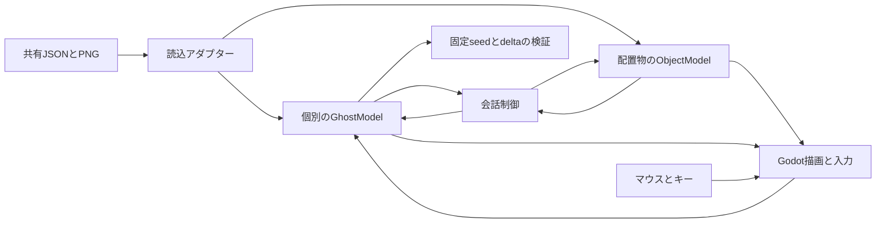
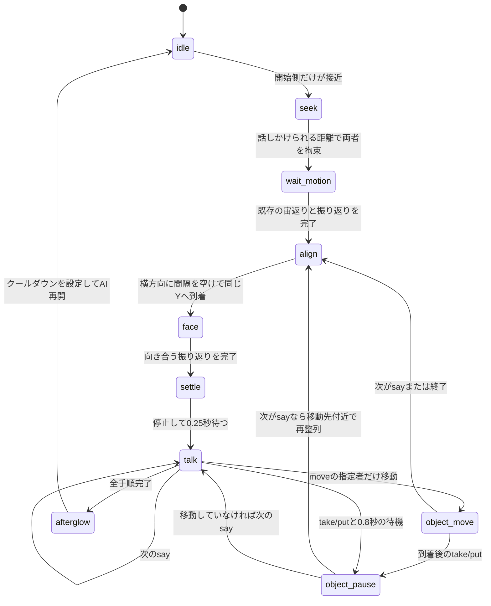
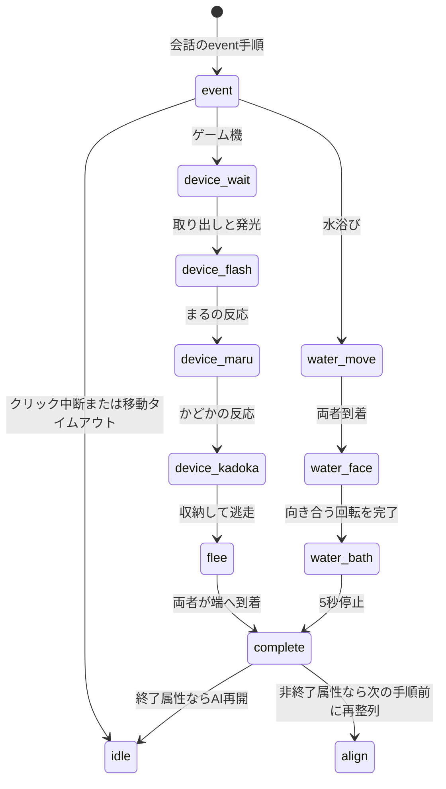

# Godot / GDScript移行: 個別移動・会話・タグ操作

追跡: Issue #54。Python版は参照実装として残し、既存のエディターやデータを変更しない。現在の範囲は通常版の描画・個別移動、say/move/take/putの会話と水浴び・ゲーム機イベント、名前ホバー、床の影、背景の周辺減光、環境粒子。配布等は未移植で、移行完了ではない。

## 責務

| 対象 | 責務 | 依存先 |
| --- | --- | --- |
| `godot/scripts/project_manifest.gd` | プロジェクト定義の共有検証と相対パス正規化 | `spec/engine/project_manifest.md` と共有22ケース。Node/Texture不要 |
| `godot/scripts/room_geometry.gd` | 部屋のサイズ・fps・移動/水場矩形・会話距離の基本検証 | `spec/map/room_geometry.md` と共有49ケース。画像/Node/RNG不要 |
| `godot/scripts/background_palette.gd` | 背景RGBとグラデーション間隔の検証・非破壊正規化 | `spec/map/background_palette.md` と共有39ケース。描画/RNG不要 |
| `godot/scripts/polygon_geometry.gd` | 背景ポリゴンの点の形とXY整数座標、非破壊正規化 | `spec/map/polygon_geometry.md` と共有35ケース。色/描画/RNG不要 |
| `godot/scripts/character_schema.gd` | キャラクターの基本条件を検証し、名前・数値・行動重みを正規化 | `spec/character/characters.md` と共有42ケース。画像/Node/RNG不要 |
| `godot/scripts/content_loader.gd` | 共有JSONとPNGの読込、初期段階の入力検証 | 通常版の `engine_project.json` / `game_content.json` |
| `godot/scripts/ghost_model.gd` | 乱数、行動選択、移動、旋回、宙返り、クリック目標 | キャラクター定義、表示サイズ、移動範囲、水場。NodeやTexture不要 |
| `godot/scripts/object_model.gd` | 配置物のタグ、初期位置、現在位置、表示状態 | 配置定義。NodeやTexture不要、JSONを書き換えない |
| `godot/scripts/conversation_deck.gd` | 共有会話JSONの検証と対応カードの選別 | say/move/take/put手順、重み。JSONを書き換えない |
| `godot/scripts/conversation_controller.gd` | 接近、回転待ち、横並び整列、発話とタグ操作の順序 | 2匹のモデル、配置物と対応カード。NodeやTexture不要 |
| `godot/scripts/event_catalog.gd` | イベントID・終了属性・必要タグの検証 | 共有 `events.json` |
| `godot/scripts/scripted_events.gd` | 水浴び・ゲーム機の時間順序、移動と終了時清掃 | 2匹と配置物。NodeやTexture不要 |
| `godot/scripts/event_view.gd` | 発光のドット状の光線 | 可視かつ発光中の配置物と表示サイズ |
| `godot/scripts/bubble_view.gd` | 日本語の吹き出しと幅に応じた改行 | モデルの発話文字列。行動状態を変更しない |
| `godot/scripts/name_view.gd` | ホバー中だけの日本語名札、画面内への配置 | キャラクターの表示名と描画矩形。入力を消費せず行動状態を変更しない |
| `godot/scripts/shadow_view.gd` | 薄いドット状の影とモデル位置への追従 | 表示サイズ、現在位置。回転や浮遊揺れを継承せず、AIを変更しない |
| `godot/scripts/vignette_view.gd` | 部屋の減光設定の純粋な検証、静的RGBAマスクと背景だけへの表示 | `room.json` の `background.vignette` と部屋寸法。AIを変更しない |
| `godot/scripts/mote_field.gd` | 粒子設定の検証、独立した環境用乱数、上昇・揺れ・再出現 | `room.json` の `motes` と基準seed。Node/Texture不要、AI乱数を共有しない |
| `godot/scripts/mote_view.gd` | 粒子の位置・色・半径・alphaを四角いドットへ描画 | MoteFieldだけ。入力・更新・乱数を扱わない |
| `godot/scripts/main.gd` | 描画、入力、ウィンドウ、固定deltaスモーク、ログ | 読込済みデータとモデル |
| `godot/tests/test_runtime.gd` | GDScriptの実挙動テスト | 読込アダプターとモデル |
| `godot/tests/test_project_manifest.gd`, `tests/test_portable_project_contract.py` | 実GodotとPythonを同じ定義ケース・期待値で比較 | 読込結果のUTF-8レポート、独立した一時ツリー、パス境界 |
| `godot/tests/test_character_schema.gd`, `tests/test_portable_character_contract.py` | キャラクターの基本条件の受理・拒否・正規化を共有ケースで比較 | 画像処理前の基本検証、UTF-8レポート、読込専用 |
| `godot/tests/test_room_geometry.gd`, `tests/test_portable_room_contract.py` | 部屋の基本幾何の受理・拒否と非破壊読込を共有ケースで比較 | 深い複製、数値表記の互換境界、UTF-8レポート |
| `godot/tests/test_background_palette.gd`, `tests/test_portable_palette_contract.py` | パレットの受理・拒否・正規化をPythonと共有ケースで比較 | 非有限値、深い複製、部屋高さとstep、UTF-8レポート |
| `godot/tests/test_polygon_geometry.gd`, `tests/test_portable_polygon_contract.py` | 点の形・整数座標の受理/拒否・正規化をPythonと比較 | 精度/型境界、深い複製、UTF-8レポート |
| `godot/tests/test_conversations.gd` | 会話デッキと姿勢・中断・再開の検証 | デッキ、モデル、コントローラー、会話場面 |
| `godot/tests/test_objects.gd` | タグ操作、到着待ち、再整列、表示状態・中断の検証 | 配置物、デッキ、モデル、シーン |
| `godot/tests/test_events.gd` | イベントカタログ、姿勢、順序、逃走、清掃の検証 | カタログ、イベント、会話、描画 |
| `godot/tests/test_hover.gd` | 回転・振り返り・重なり・画面端・入力変換・全画面の検証 | シーン、名前表示、注入したマウス/キー入力 |
| `godot/tests/test_shadows.gd` | 影の画像、宙返り終了時の連続性、床と岩の描画順を検証 | モデル、影、実描画のピクセル比較 |
| `godot/tests/test_vignette.gd` | 減光設定と画像、前景保護、画面サイズ・入力非干渉の検証 | 検証関数、読込アダプター、シーン、実描画のピクセル比較 |
| `godot/tests/test_motes.gd` | 粒子設定と時間更新、再出現、乱数独立性、描画・入力の検証 | 粒子モデル、シーン、実描画のピクセル比較 |
| `tests/test_godot_runtime.py` | Godot実行テストをPythonのテスト入口に接続 | `GODOT_BIN` またはPATH上の `godot` |
| `engine/godot_runner.py` | Godotの共通起動準備、検出・バージョン確認とCLI同期プレイテスト | 共有マニフェスト、Godotソース。Tk・Pythonゲームには依存しない |
| `engine/process_launcher.py`, `tests/test_godot_process_launcher.py` | 準備済みGodotの子プロセス起動、終了コードと永続UTF-8ログ | 共通起動準備、既存LaunchedProcess。GUI操作は後続 |
| `tests/test_godot_preparation.py` | 準備workerとFuture、選択保持・例外・キャンセル・明示起動の検証 | 起動準備とlauncher。Tkは使わない |
| `tests/test_godot_runner.py` | CLIの選択・引数・失敗・終了コードの契約 | Godot不要のモック、実起動はGodotRuntimeTests |



## 共通の挙動

- 左上原点・右がX正・下がY正。内部画面960x540、16:9を維持し全画面時も伸ばさない。
- 透明余白を除いたキャラクター画像を `display_height` に合わせる。まるの元の向きは `native_facing=-1`。
- キャラクターIDと基準seedから各モデルの専用乱数系列を作る。通常起動では時刻から基準seedを変え、`--seed` 指定で固定する。キャラクターの更新順や相手の抽選数に影響されない。Pythonとの乱数列一致は要求しない。
- 行動は停止、前進、高速前進、360度進路変更、大きな移動宙返り、水場での停止と会話への接近。JSONの重みを使う。`seek_talk` は対応会話があり、両者のクールダウンが切れた時だけ候補にする。
- 進路抽選の78%は左右主体。顔の後方へ進む時は0.6秒の振り返りを完了してから動く。壁での反射も同様。
- 浮遊揺れは0.17〜0.29Hzに性格倍率を掛ける。停止中も描画上の上下揺れは継続し、基準位置は動かない。
- 宙返りは5.8〜8.2秒の一周。直進を加えた楕円軌道で進行方向へ離脱する。Godotは時計回りが正なので回転符号はpygameとは逆。空間が足りない時は前進に戻る。
- 左クリックで左右に60pxずつ間隔を取った位置へ寄る。宙返りや振り返りは中断せず完了してから向かい、到着後は通常AIへ戻る。
- F11 / Alt+Enterで全画面切替、Escで終了。共有配置の `visible` を尊重しゲーム機は初期非表示。

## 通常会話

`conversations.json` を直接読み、対応カードを `weight` に比例して抽選する。2回以上の発話も配列順に再生する。旧形式の `kadoka` / `maru` の文字列もsay手順に正規化する。重みは有限の1〜999、話者は `kadoka` / `maru`、発話は非空文字列。不正なカードで起動を止め、共有ファイルは修正しない。

カタログに存在するがハンドラーが未実装のeventを含むカードは**カード全体を除外**する。カタログにないIDは入力エラー。move/take/putやイベントに必要な配置タグが欠落するカードも全体を除外する。途中の台詞や取り出しだけを実行しない。起動ログに対応カード数、未移植除外数、タグ欠落除外数を出す。対応カードがゼロなら会話行動を選ばない。現在の共有デッキはイベント2件も含め25カードが対応する。



相手は話しかけられるまで通常AIを続ける。受け手が宙返り中でも中断せず完了を待つ。壁付近でも会話距離（標準145px）を維持して横並びにする。発話中は位置・向き・回転角を固定し、描画上の浮遊だけを続ける。1つの発話だけを吹き出しに出して重なりを避ける。日本語システムフォントを使い、長い台詞は250px幅で改行する。

会話終了後は1.2秒の余韻と12〜24秒のクールダウンを置く。接近・整列が25秒以内に完了しなければ解除して通常AIへ戻る。会話中のクリックは会話を中断し、宙返り・振り返りを完了してからクリック地点へ集合する。モデル同士の参照は弱参照にして循環参照を避ける。

## タグ付きオブジェクト操作

配置IDと非空タグは一意にし、曖昧な対象を拒否する。タグなし配置は描画用として許可する。タグはPython版と同様、前後の空白を除き内部の空白を `_` へ変換する。位置・幅は有限、visibleは真偽値。JSON/PNG読込後、描画とは独立したモデルが位置と表示状態を持つ。

| 手順 | 対象と処理 | 次へ進む条件 |
| --- | --- | --- |
| move | actorのkadoka/maru/bothだけを対象タグの位置へ移動。非表示なら初期位置。Yは対象の38px上、bothは左右54pxずつ。移動範囲へクランプ | 全指定者の到着と振り返り完了。25秒で解除 |
| take | 対象を指定者の顔の前方42px・下18pxへ置き表示。bothでも1個を開始側の位置へ置く | 0.8秒の待機 |
| put | 対象を非表示にする。現在位置と初期位置は保存 | 0.8秒の待機 |
| say（move後） | 移動した指定者の到着位置を中心に再整列し、停止して向き合う。次のsayを消費せず待つ | 整列・振り返り完了と0.25秒の待機 |

指定者以外はmove中その場で浮遊し、発話前の再整列で合流する。移動や回転中の吹き出しは消す。take/putは実行中の状態変更で、配置JSONやPNGへ書き戻さない。take後にオブジェクトがキャラクターを追従する機能はなく、Python版と同じく取り出した位置に置く。クリック中断・タイムアウトで移動拘束を解除するが、通常のtake/putの適用済み変更は巻き戻さない。専用ゲーム機イベントが取り出した物だけは終了・中断時に非表示へ戻す。

## 専用イベント

`events.json` のschema_version、重複しないID、表示名、真偽値のterminal、任意のrequired_tagを検証する。terminal=trueの手順はカードの最後だけに許可する。実装済みハンドラーはwater_bath/game_device。既存エディターで保存した共有カードを直接使う。

| イベント | 流れ | 姿勢と清掃 |
| --- | --- | --- |
| water_bath | 水場の左右へ移動 → 到着・振り返り完了 → 向き合って5秒停止 → 終了 | 会話距離を確保し同じYに並ぶ。浮遊だけ継続。水場タグがあれば配置位置、なければ部屋のwater_rest中心を使う |
| game_device | 0.8秒待機 → まるが取り出し発光・「ピカーン」1.2秒 → まる「まぶしいのだーーー」2.4秒 → かどか「まぶしい」1.5秒 → 収納して左右の端へ逃走 → 終了 | 発話は重ならないよう順次再生。発話中は停止・向き合いを維持。逃走の基準速度175px/sに性格倍率。先に振り返って前方へ移動 |



会話と同じく、回転中に発話しない。水場が端にある場合もペア中心をクランプして横間隔を維持する。waterタグの水面は床として2匹の背面へ描画し、顔を隠さない。移動段階は25秒で解除。イベント開始後のゲーム機は通常終了・クリック中断・タイムアウトの全経路で収納し、発光も消す。イベント外でtakeされた他の配置物には触れない。起動時に必要タグが欠落するカードは抽選不可にし、台詞だけの部分実行を防ぐ。イベントは乱数を追加消費せず、両者の通常AIの独立性を保つ。

## 名前ホバー

表示名は `characters.json` から読んだモデルの `display_name` を使う。描画中のSpriteのローカル矩形で判定し、透明ピクセルごとの判定は行わない。回転・左右反転・振り返りの横幅・浮遊後の位置を反映し、重なった場合はYソートで手前に描かれる1匹だけを選ぶ。同じYなら後から追加したSpriteを優先する。画面から隠したSpriteは対象外。

名札は回転・反転しない独立した描画ノードで、実際の回転後の外接矩形の下へ配置し、内部画面の端から6px内側に収める。吹き出しより後ろのレイヤーにし、会話の上側の表示と併用できる。マウスが離れる・ウィンドウから出ると消す。

マウス入力はウィンドウ座標で保持し、各描画更新でViewportのstretch/letterbox変換とCanvas変換を逆適用する。これによりマウスを動かさなくても、おばけの移動やウィンドウサイズ変更・全画面切替に追従する。入力を消費しないのでクリック集合も従来どおり動く。乱数、行動、会話、共有データへの書込みは行わない。入力変換テストはGodot公式の [Viewport API](https://docs.godotengine.org/en/stable/classes/class_viewport.html#class-viewport-method-push-input) の `push_input` を使う。

## 床の影

各おばけに独立した `ShadowView` を1つ用意する。表示幅の58%・表示身長の8%（最低5px）のRGBA画像を一度だけ生成し、原典と同じ2本の矩形・色 `(0,0,5)`・alpha 46/34で描く。矩形の重なりはalphaを加算せず、後の矩形で上書きする。画像をフレームごとに作り直さず、nearestでドット感を維持する。

影の中心Xはモデルの現在X、上端Yは現在Y + 表示身長/2 + 19px。Godotモデルの現在位置には宙返りの移動軌道が含まれるため、開始位置へ固定したり終了時だけ位置を切り替えたりしない。左右の宙返りから次の前進まで1/60秒刻みで追従・連続性を検証する。細かな浮遊揺れ、回転角、左右反転、振り返りの横幅は影に適用しない。おばけを非表示にした時は影も非表示にする。

影はキャラクターSpriteの子ではなく、床専用の独立レイヤーに配置する。水面と同じz=0で水面より後に描き、z=1の岩とおばけより後ろにする。実描画の表示あり/なしのピクセル比較でこの順序を確認する。影は名前ホバーの対象にせず、乱数・行動・会話や共有データを変更しない。Python版の描画処理はこの移行作業では変更しない。

## 背景の周辺減光

`background.vignette` の色、max_inset、step、border_width、radius、alpha_start、alpha_divisor、min_alphaを直接使う。色は3つの0〜255の整数値、他の項目はPython側と同じ範囲の有限な整数値として検証し、欠落・文字列・真偽値・小数・非有限値・範囲外を拒否する。max_inset=0は減光なし。読込アダプターからこの純粋な検証を呼び、描画の前にエラーにする。既存の全部屋JSON検証との完全互換はまだ保証しない。

insetを0からmax_inset未満までstepずつ増やし、矩形 `(inset, floor(inset/2), width-2*inset, height-inset)` に角丸の枠を描く。alphaは `max(min_alpha, alpha_start-floor(inset/alpha_divisor))`。重なりは前のalphaへ加算せず後の枠で上書きする。角丸半径は矩形へクランプし、内側の穴がなくなる太い枠にも対応する。角の境界はピクセル中心の走査で求めるため、pygameの丸みとの完全な画素一致は保証しない。

マスクは起動時に一度だけ生成して内部部屋サイズへ固定し、nearestで描画する。背景グラデーション・ポリゴンの後、worldの水面・配置物・おばけ・影とUIの前に描画する。中央は透明。全画面や余白付きウィンドウでは背景と同じstretchを使い、別のウィンドウサイズ画像を生成しない。マスクは入力を消費せず、ホバー対象にもならない。AI乱数・会話・評価ログ・共有ファイル・Python版を変更しない。

通常マスクの表示あり/なし、余白付きウィンドウ、全画面を保存して確認する。前景保護のピクセル比較はテスト内だけで濃いマスクを使用し、実際にマスクがある位置のおばけ・水面・吹き出し・名前を確認する。スクリーンショットのテクスチャは黒帯を含まないのでstretch変換を使い、黒帯を含むウィンドウのfinal変換とは区別する。全画面切替とクリックは入力注入で検証し、手動入力とは分けて扱う。

## 環境粒子

共有部屋の `motes` を直接使い、count、x/y/reset_yの範囲、top、speed_range、drift_speed/amount、radii、alpha_range、colorを検証する。countは0〜1000、半径候補は1〜100の整数値、alphaと色は0〜255の整数値。有限な座標・速度範囲は下端<上端、速度は非負、alpha範囲は等値も許可する。topは部屋の高さ以内、揺れの速度・幅は0〜100。不正型・欠落・非有限値・範囲外は読込時に拒否する。count=0は有効な無効化設定。

MoteFieldはRefCountedの環境専用モデル。基準seedから `scenery/motes` の名前空間で専用RandomNumberGeneratorを作り、かどか・まる・会話の乱数を共有しない。設定を複製して保持する。開始時に位置・速度・位相・半径候補・alphaを抽選し、半径配列の重複を重みとして残す。Pythonとの乱数列一致は要求しない。

mainのゲームdeltaで環境のelapsedを進め、`y -= speed*delta` と `x += sin(elapsed*drift_speed+phase)*drift_amount*delta` を適用する。topを越えた時だけx_range/reset_y_rangeへ位置を再抽選し、速度・位相・半径・alphaは維持する。範囲は開始・再出現の範囲で、横移動を強制クランプしない。通常の移動と描画は乱数を消費せず、0や負値・非有限deltaは状態を変えない。

MoteViewはモデルの整数化した中心から半径分を引き、2倍半径の四角をalpha付きで描く。フレームごとの画像や粒子Node生成はしない。水面・床の影より前、岩とおばけのz=1より後ろ、UIより後ろに配置する。Python版では配置物の上に粒子を描くが、Godot版の岩は前景として粒子を隠す。顔や文字を隠さないことを実描画で確認する。全画面や黒帯付きウィンドウでも内部座標と同じstretchを使い、粒子をホバー対象や入力の受け手にはしない。

ヘッドレスでは同じseed/deltaの再現性、100秒の再出現、描画更新の非干渉、無効化と設定検証を確認する。実描画では共有設定の開始時・4秒後・画面サイズ変更を保存し、固定の明るい粒子で水面と前景の重なりを比較する。保存画像は黒帯を含まないのでstretch変換でサンプルし、ウィンドウ入力はfinal変換を使う。実行中の粒子状態は共有JSONへ保存せず、既存AI評価ログにも追加しない。

## 読込と配布の境界

背景色と描画間隔は `background_palette.gd` で画像読込前に検証する。グラデーション上/下と全ポリゴンのRGBは0〜255の整数値、stepは1〜部屋高さの整数値とし、小数部・真偽値・文字列・非有限値・範囲外を拒否する。成功時は背景全体を深く複製し、対象値だけ正規化する。ポリゴン座標や減光等の未知/未検証設定は保持し、後続の従来検証へ渡す。

Pythonと共有39ケースで比較し、整数値の小数表記の違いは別テストで明示する。ポリゴン座標の完全な整数/大数互換・減光/粒子を含む全入力や描画の画素一致は未完了。JSON/PNGや描画処理を変更したとは扱わない。fixtureと起動検証は [背景パレット契約](../spec/map/background_palette.md) を参照。

部屋の基本幾何は `room_geometry.gd` で画像読込前に検証する。16:9のサイズ、fps、移動/水場矩形、会話距離を共有49ケースで比較する。矩形は整数値で正の幅/高さ、部屋内の範囲とし、巨大数・小数部・真偽値・非有限値を拒否する。元の部屋JSONを変更せず、未検証の設定・追加フィールドも深く複製して保持する。失敗時は部分結果を返さず、次の読込でエラーをリセットする。

基本検証は複数の16:9寸法と会話距離1〜部屋幅を扱えるが、通常版ランタイムは960x540・距離80〜300の制約を画像読込前に確認する。fpsの実行時反映・任意寸法の描画/AIは今回移植しない。Godot JSONは整数トークンと整数値の小数表記を区別できないためPythonと完全な型互換とは扱わない。詳細と未対応の背景/粒子等は [部屋幾何契約](../spec/map/room_geometry.md) に記す。

キャラクターは `character_schema.gd` の基本検証を全件へ適用してから画像を読む。開始位置の部屋内範囲、名前・IDの非空と正規化後の重複、吹き出し位置や数値・行動重みを検証する。整数化と既定値をPythonに合わせ、向き0は1に正規化する。元のJSON/Dictionaryは変更せず、途中の不正値で部分結果を返さない。正規化済み定義を既存のモデル・描画へ渡す。通常版の2匹制約は基本検証とは別に、画像を読む前に確認する。

共有42ケースは [キャラクター基本契約](../spec/character/characters.md) を正とする。Pythonの数値文字列・非文字列メタデータ等の互換変換や画像パス検証の完全一致は未対応。Godot側だけの巨大数・非有限値拒否と読込エラー後の再利用も実体で確認する。全入力互換を完了したとは扱わない。

ソース実行時は `godot/` の親を通常版のコンテンツルートとして読む。PNGやJSONをGodot専用コピーへ分岐させない。`--content-root` で別の通常版ルートを明示できる。

`project_manifest.gd` は定義ファイルの絶対パスを受け、親フォルダーをルートとして読込結果を正規化する。名前・project_type・入口・エディター・外部/インラインcontentを検証する。外部定義内もプロジェクトルートから解決し、両contentを検証してからインラインで上書きする。未知のproject_typeは定義の読込では保持し、通常版ランタイムでstandard以外を拒否する。PNGを読む前にこの共通検証を通し、失敗時に部分的な結果を返さない。

共有22ケースをPython/Godotの同じテスト入口で比較する。内部 `..` はルートから逸脱しない場合に正規化でき、ディレクトリcontentやルート `.` も保持する。定義APIは別名ファイルを読めるが、ゲームと統合CLIは `engine_project.json` 固定のまま。エディター定義のscriptやentrypointはファイルの存在だけを検証し、実行しない。

読込アダプターはJSONの各パスフィールドにプロジェクト相対パスだけを許可する。ルート外参照、絶対フィールドパス、リンク経由、欠落画像を拒否し、エラーで終了する。リンクは `..` を正規化する前にも拒否する。絶対パス・リンク・非文字列の互換変換や、部屋/キャラクターを含むPythonの全検証条件との一致はまだ対象外。Godotの起動シーンは `main.tscn` であり、Pythonマニフェストの `game.py` を実行しない。読込で共有JSONを書き換えない。

Godotのエクスポート/PCK単独配布は未対応。今はリポジトリのJSON/PNGが必要。起動コマンドとGodot実行ファイルの指定は [Godot版README](../godot/README.md) を参照。

背景ポリゴン座標は [基本契約](../spec/map/polygon_geometry.md) の35ケースでPythonと比較する。3点以上・各点のXY整数値を全層で画像読込前に確認する。Godotの共有範囲は絶対値2^53-1以下、整数値の小数表記やPythonの任意精度整数との差は専用テストで明記する。画面外・負座標、重複/共線は許可し、形の描画可能性や画素一致は保証しない。読込でJSONを変更せず、失敗後の再利用も確認する。

## 統合CLIのプレイテスト

`engine_app.py --playtest-godot` から、既存エディターで保存した選択プロジェクトの共有JSON/PNGを直接読む。Pythonマニフェスト検証後、リポジトリのGodotソースを起動し、`--content-root` に選択したrootを渡す。選択と異なる部屋を暗黙に起動しないよう `engine_project.json` の名前を必須とし、special版はプロセス起動前に拒否する。汎用Starterのキャラクター構成はまだ未対応。

`--godot-bin` > `GODOT_BIN` > PATHのgodot/godot4で検出する。明示した実行ファイルが存在しなければ失敗し、他の候補やPythonゲームにフォールバックしない。`--version` をUTF-8で捕捉して10秒以内にGodot 4と確認し、失敗・時間超過・他バージョンは起動しない。実行引数はshellを介さない配列。`--` の前はGodotのpath/headless/fixed-fps、後はcontent-root/test-frames/seedとする。

CLIは同期実行でゲーム終了まで待機し、標準出力/標準エラーを引き継いで実際の終了コードを返す。構成/プロセス起動の例外はstderrへ表示して1で終了する。成功メッセージを先に出さない。headlessは正のフレーム数が必須、seedは符号付き64bit。フレーム指定時は60fpsの固定deltaで検証する。Godotオプションを別のengine_appモードへ指定した場合も黙って無視しない。

共有データのコピー・書換えやゲームロジックの変更はない。モックで実行ファイル・引数・終了コードを確認し、実体で既定プロジェクト、空の会話デッキへ編集した別フォルダー、不正な粒子数の起動失敗を検証する。既存エンジンGUIのPython版起動、エディター、子プロセス監視はこの移行では変更しない。

## Godotの子プロセス起動API

例えば、GUIでゲームを起動した直後に閉じても原因を調べられるよう、Godotの出力を `tmp/launch_logs/godot-*.log` に残す。以下はGUIを使わず子プロセスと診断情報を取得する例で、GUIへのボタン追加を意味しない。

```python
from pathlib import Path
from engine.manifest_loader import load_project_manifest
from engine.process_launcher import ProcessLauncher

manifest = load_project_manifest(Path("engine_project.json"))
child = ProcessLauncher(manifest).launch_godot(
    headless=True, test_frames=180, seed=12345,
)
print(child.log_path)       # stdout/stderrをまとめた永続UTF-8ログ
print(child.poll())         # None: 実行中、0: 正常終了、その他: 異常終了
print(child.log_tail())     # 最大8192byteの末尾。PIPEを待たない
```

Godot実行ファイルは `executable=Path(...)`、`GODOT_BIN`、PATHの順。CLIと同期APIは `prepare_godot_invocation()` の同じ検証・引数を使う。準備は同期で、バージョンprobeだけ10秒上限。この同期APIをTkのメインスレッドで呼んでもGUIが絶対に止まらないとは保証しない。準備を分離するAPIは下記。

APIは選択した定義と現在の `engine_project.json` が一致しない場合に再読込を要求する。specialや不正設定、実行ファイル/probeの失敗はゲーム起動前に例外を返し、Python版へフォールバックしない。起動準備の成功はJSONの全意味検証・ゲームの初期化成功を保証せず、子プロセスの終了とログを必ず確認する。

ゲームは終了を待たず `LaunchedProcess` を返す。標準出力/エラーは毎回一意なログへ直接渡し、親のファイルハンドルは閉じる。ログはウィンドウを閉じた後もファイルに残し、末尾だけを読み取る。API自身は子プロセスを終了させないが、OSや実行ホストによる終了まで防ぐ保証はしない。Windowsではバージョンprobeと子プロセスのコンソールを隠すフラグを使い、対話実行にはheadlessを付けない。終了待機は呼び出し側のテストだけで実行し、API自身はゲーム完了を待たない。

実Godotで実行中の戻り値、編集した別プロジェクトの正常終了、日本語の画像欠落エラーと非0終了を確認する。既存Pythonゲーム/エディター起動とGUI監視の回帰もテストする。共有JSONを書き換えず、GUIの起動方式選択・既存監視への接続は後続範囲。

### 準備workerと明示起動

例えば、バージョン確認中に別のプロジェクトへ切り替えても、古い準備が勝手にゲームを開かないようにする。`prepare_godot_async()` は準備だけをdaemon workerで行い、完了/失敗をFutureへ保存する。ゲームを起動するのは呼び出し側が明示的に結果を渡した時だけ。

```python
launcher = ProcessLauncher(manifest)
preparation = launcher.prepare_godot_async(headless=True, test_frames=180, seed=12345)

# GUIのmain threadで定期確認する部分の例。1つの結果は1回だけ処理する。
if preparation.done():
    invocation = preparation.result(timeout=0)  # 失敗/キャンセルはここで例外
    child = launcher.launch_prepared_godot(invocation)
```

GUIへ接続する時は未完了でresultを待たず、main threadのafter等でdoneをポーリングする。完了後にもう一度同じ結果を起動しないよう、処理済みの要求を取り除く。Futureの完了callbackはworker上で動く場合があるため、そこからTkウィジェットを操作しない。GUIへの実際のボタン/ポーリングはまだ追加していない。

| 段階 | 実行する処理 | ゲーム起動 |
| --- | --- | --- |
| API呼出し | 明示パスを絶対化し、選択定義を深く複製。Futureとworkerを作る | なし |
| daemon worker | 共有のマニフェスト/引数/実行ファイル検証とversion probe。結果または例外をFutureへ渡す | なし |
| 呼び出し側の明示起動 | 共有準備器から得た信頼済みinvocationと現在のlauncherの選択を比較し、既存ログ付きPopenへ渡す | あり |

未開始の要求だけFuture.cancelで止められる。準備が実行中ならキャンセルはFalseで、probeの中断は行わない。ただしGUI終了/選択変更時に要求と結果を捨てればゲームは起動しない。workerはdaemonで、親アプリの終了を待たせる常駐executorを作らない。OSや実行ホストがprobeを終了させるタイミングまで制御する保証はない。

相対パスと選択定義はAPI呼出し時に保持する。未指定のGodot実行ファイルはworker実行時の環境/PATHから検出する。共有ファイルの内容は複製/ロックせず、準備とゲームが読む時点の値を使う。明示起動ではprobeやファイル検証をもう一度同期実行せず、選択スナップショットの一致だけ確認する。原子的な再検証や全入力互換の保証ではなく、最終的な初期化の成否はゲームの終了/ログで確認する。

実Godotで準備完了までゲーム用ログが作られないこと、その後の明示起動で正常終了/日本語エラーが記録されることを確認する。同期CLIと旧APIの挙動は維持する。

## 未移植

GUI側のGodot選択・Futureポーリング・監視への接続、全部屋・キャラクター入力の完全な共有検証、Python/Godot評価ログ比較、配布構成。準備workerと子プロセス/ログ取得APIは上記の範囲で実装済み。システムに日本語フォントがない環境や配布時のフォント同梱は後続対応。

評価ログは10フレームごとに `frame`、`ghosts`（name/x/y/vx/vy/facing/action/turning/spin/target/talk）、`conversation`（phase/initiator/step/completed/movers/event/last_event）、`objects`（id/tag/x/y/visible/glowing）をJSONLに記録する。eventにはid/phase/timerを含む。Python版の評価ログとの完全互換ではない。
