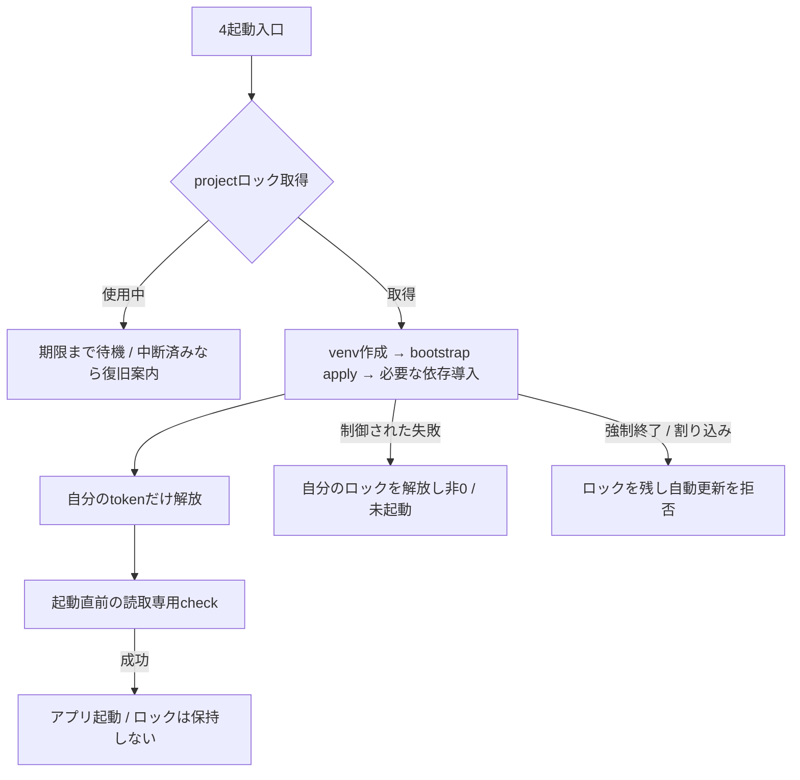

# 共有venvの準備と起動（Issue #113）

## 目的と範囲

Windowsの4起動バッチと手動起動を `tools/security/script/launch.py` に集約する。projectの `.venv` 作成・tooling修復・必要な依存導入だけを直列化し、アプリの実行中はロックしない。ゲーム/UIやglobal Pythonのパッケージは変更しない。

## 契約

| 状態 | 処理 |
| --- | --- |
| 準備中の別起動あり | project内 `.venv-setup.lock` ディレクトリの原子的作成が失敗したら待機。既定300秒、0〜3600秒で指定可 |
| ロック取得 | UUID token・PID・UTC時刻を専用ownerファイルへ記録してからvenv作成/apply/依存確認・導入 |
| 正常または制御された子コマンドの失敗 | 子コマンドの終了を待ち、自分のtokenが一致した場合だけownerファイルと空ディレクトリを削除。失敗時は未起動 |
| Ctrl+C・強制終了 | ロックを残す。子pipが残っている可能性があるため、PID不在や古さだけで自動回収しない |
| 所有者PID終了 | 次の起動は準備を始めず、手動復旧が必要と表示。PIDの再利用/権限不足も自動回収の根拠にしない |
| 復旧 | owner tokenが一致・所有者PID終了・利用者による全準備プロセス終了の明示確認が揃った時だけ回収。未知/壊れたmetadataは自動回収不可 |
| 準備成功後 | ロックを解放し、起動直前のbootstrap読取専用checkを実行してから固定のアプリを起動 |

OSの自動解放ファイルロックだけでは、親が終了した後も子pipが動く間に次の更新が始まり得る。このため持続する排他ディレクトリを使い、所有者終了を「安全に回収できる証明」とはしない。通常の安全な環境も短い準備確認は直列だが、他のゲーム/エディタが閉じるまで待たせたり、毎回パッケージを取得したりはしない。

## 復旧

1. コンソールのPID/tokenと `.venv-setup.lock/owner-<token>.json` を照合する。
2. そのprojectに関係するvenv作成・bootstrap・pipのプロセスが全て終了したことを利用者が確認する。他者のプロセスを自動終了しない。
3. `python -I -B tools/security/script/launch.py --recover-lock <token> --confirm-no-setup-processes` を実行する。これは明示の手動回収で、通常起動が自動実行することはない。
4. 破損したmetadata、再利用されたPID、状態不明の場合は回収を拒否する。手動調査する。部分venv/pip欠落は既存のensurepip→bootstrap手順で復旧し、venv自体は自動削除しない。

metadata作成前/書込中の中断（Ctrl+Cを含む）、ディスク障害、ownerファイル削除後のディレクトリ解放失敗では、空/破損したロックが残りtoken復旧を使えないことがある。この場合も起動処理は削除しない。全起動入口を閉じ、同じprojectのvenv/bootstrap/pipの親子プロセスが全て終了したことを確認した後、projectルートにある**その `.venv-setup.lock` だけ**を別名（例 `.venv-setup.lock-investigate-日時`）へ手動で変更して証拠を保管する。確認できなければ変更せず調査を続ける。`.venv` や他projectのロックは触らない。通常の例外によるmetadata書込失敗は、子プロセス開始前に自分の部分ファイルと空ディレクトリだけを片付ける。Ctrl+Cなどの割り込みでは残す。

Windowsのmetadata読取と解放が重なる場合は、共有違反だけを最大1秒再試行する。解消しない場合は非0で未起動になる。ロック解放後の読取専用check中に別入口の更新が始まってcheckが失敗する場合も、安全側に未起動として再起動を促す（全起動成功やアプリ実行中の依存不変までは保証しない）。

バッチ入口でロックを検出した場合は、作成途中かもしれないvenvのPythonではなくbase Pythonで共通処理を起動して待機する。base Pythonが利用できない場合や、この判定とPython起動の間にvenvが作成/変更された場合は、非0で起動できないことがある。手動起動もこの間はbase Pythonを使う。すべての更新はロック内だが、構築途中のinterpreterで起動できることは保証せず、失敗したら先行する準備の終了後に再起動する。

ロックは同じローカルprojectの対応入口間だけを調停する。手動pip、別のIDEやCI、ネットワークファイルシステム、同じ権限を持つ悪意あるプロセス、アプリ起動後の依存差替えを防ぐセキュリティ境界ではない。OS信頼ストア・全TLSチェーンの拒否・Python本体更新は親 #99 に残る。実GUIの準備完了/起動後クラッシュは保証しない。

## 検証

ロックの所有者/時間切れ/強制終了/手動回収を標準ライブラリの別プロセスで確認する。実Windows CMDでは4入口の既存失敗経路に加え、2入口同時起動の更新重複なし・制御された更新失敗後の解放・アプリ実行中にロックを保持しないことをfixtureで検証する。これらは外部取得・実GUI操作・全TLSの証拠とは区別する。
