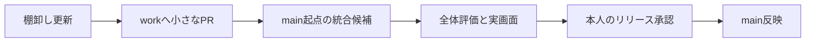

# mainとworkの統合計画

[Issue #86](https://github.com/tomiya7688/obake-no-sumika/issues/86)の棚卸し案。main固有の改善とworkのGodot実装・共有契約を両方残し、段階的に統合する。通常の1回分の開発は[ワークフロー](ワークフロー.md)に従う。main反映・タグ・公開は本人のリリース承認後に行う。

## 比較対象と確認コマンド

2026-10-17に取得したmain `43c02c7`、work `80b4f48`、共通祖先 `6d6643c` を初回の基準とする。この時点ではworkのみ68コミット、mainのみ23コミット。完全なSHAと23件の対応先は [main_work_inventory.json](../../tools/repo_sync/main_work_inventory.json) が正本。

```powershell
git fetch origin
.\.venv\Scripts\python.exe tools/repo_sync/script/inventory.py
.\.venv\Scripts\python.exe tools/repo_sync/script/inventory.py --json
```

検査は追跡refを読み、fetch・merge・cherry-pick・checkout・ファイル更新を行わない。`consistent` はコミット集合と分類の対応が一致する意味であり、取り込み完了や意味的な同等性の保証ではない。mainの更新、比較基準からのwork巻き戻し、共通祖先の変更、未分類・余剰コミットがあれば `needs_refresh` と終了コード1を返す。入力不正・履歴不足は2。workが通常の開発で先へ進むだけなら再分類は不要。

shallow cloneや追跡refがない環境では必要な履歴を別途取得する。Work CIは一時Git fixtureで検査処理をテストするが、本番リポジトリの全履歴監査はこのコマンドで行う。

## main固有の変更と取り扱い

分類値は `port`（workへ選択的に取り込む）、`replaced`（該当目的は対応済み）、`reference_only`（Python参照版の範囲に残す）、`obsolete`（明示的に不要と判断）の4種。今回、不要として捨てる変更はない。複数目的を持つコミットは複数グループへ割り当てる。

| 意味単位 | 分類 | 対応方針 |
| --- | --- | --- |
| AI向けルーター・探索停止・詳細契約分離 | port | mainの5コミットを現行の `docs/context/` と責務表へ適応する。旧索引のPython専用説明やロードマップ部分読みに戻さない |
| stage済み・未stageの上限付きsnapshot | port | 2コミットの機能とテストを既存 `tools/` へ統合。workのdirty booleanと同等とはしない |
| PR #23のmerge記録 | replaced | 構成7コミットを別途分類済み。追加パッチとして重ねず、統合候補で履歴は保持 |
| 初期CIとrunner.temp参照修正 | replaced | 2コミットの基本評価目的はPR #87で対応。後続の品質・型・性能ゲート全体を置換したわけではない |
| ライセンス境界とMIT本文 | port | mainとworkの現行文言の違いを残して所有者確認。今回ライセンス変更はしない |
| Ruff lint/formatとUPD | port | 設定・ゲートを移植。整形差分は新しいworkソースへ再適用し、古い全ファイルで上書きしない |
| 品質チェッカーのlatest-first方針 | port | 方針・更新運用を保持。GodotやActionの固定とは別の対象として扱う |
| Python共有エンジンの絶対性能・base/head回帰 | port | 編集ツールにも残るPythonエンジンを同じrunner条件で再計測して適応 |
| game.pyの性能計測・閾値 | reference_only | 同じ2コミット内でもPythonゲームの計測は参照版レーン。Godotの測定結果に読み替えない |
| Mypy基準と型境界・fixture改善 | port | mainの基準36件と減少方向の運用を保持して再計測。36件はエラー0の意味ではない |
| かどか・まるの新画像 | port | mainは192×192、workは1152×1152で別のblob。表示身長・透過・向きを確認して共有素材として取り込む |
| nearest拡縮とREADME | port | Pythonはsmoothscale、GodotはLANCZOSの箇所が残る。対応済みと扱わず、実描画と説明を揃える |

元のファイル、work側の対象、個別の検証条件はJSONの `groups` に記録する。取り込み対象と書かれたグループは将来の実装範囲であり、この棚卸しPRで適用するパッチではない。

## 段階的な統合順序



1. **棚卸し**：上記コマンドと元の差分で分類を確認する。取得したrefが変わったら、古い一覧を前提に進めない。
2. **work側の小さなPR**：コンテキスト機能、品質/型、性能、素材/拡縮を独立に適応する。既存のGodot必須CI・共有ケース・通常版とspecialの分離を毎回維持する。ライセンス境界は所有者確認を伴う別単位とする。
3. **統合候補**：リリース準備が整ってから、更新したmainを起点とする専用候補ブランチへ、検証済みworkを統合する。CIやライセンスを含む競合を一覧と照合して解消し、一括のours/theirs選択で捨てない。候補の作成・検証とmainへの反映を分ける。
4. **候補の受入確認**：下表を満たし、root README・release文書・起動入口をその候補の構成へ揃える。現在のPython GUI既定起動とGodot CLIの区別を、未実装のGodot既定起動として書き換えない。
5. **本人の確認と公開**：候補SHA・実行結果・未確認項目を提示し、Kadoka本人のリリース確認を得る。通常開発のwork取込許可だけでmain・バージョン・タグ・Releaseを変更しない。

## 統合候補の受入条件

| 範囲 | 必要な確認 |
| --- | --- |
| 共有入力・Godot | `scripts/evaluate_project.py --require-godot --frames 900`、既存shared/portableケース、JSON非破壊確認、strict責務監査 |
| 品質・型 | 移植したRuff/UPD/Mypyゲートの実行結果。baselineの根拠と実エラー数を分ける |
| 性能 | mainの絶対閾値と同一runner比較を維持。Pythonゲーム・共有エンジン・Godotの結果を分離 |
| 素材・描画 | 新画像、同身長、前向き移動、宙返り、会話、水浴び、ゲーム機、全画面の実描画と実GUI |
| 文書・権利 | root READMEの現行ランタイム、Python参照版と開発ツールの位置付け、Godot起動手順、ライセンス範囲、VERSION/release文書の整合 |
| 最終確認 | 候補SHAを固定した本人のリリース承認。PR #78の実GUI未確認を自動CI成功で置き換えない |

この段階では統合候補の作成・性能/型ゲートの移植・画像交換・main反映は未実施であり、Issue #86は継続する。
