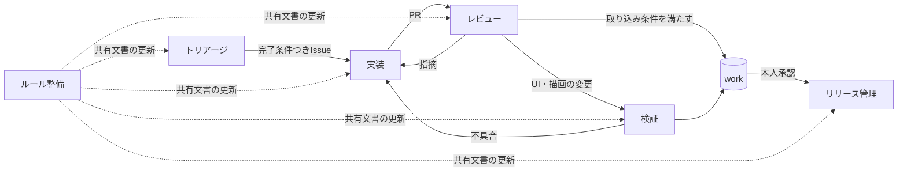

# 役割別ワークフロー

1つの作業を役割に分けた時の手順。1つのエージェントが複数の役割を順に担ってもよい。どの役割も [共同作業ルール](共同作業ルール.md) に従う。

## 役割の流れ

## 役割一覧

| 役割 | 入力 | 出力 | 読む文書 |
| --- | --- | --- | --- |
| トリアージ | 新しい要望・不具合・評価結果 | 優先度と完了条件つきのIssue | [Issue優先度](Issue優先度.md) |
| 実装 | 着手可能なIssue | `work` 宛てPR | [ワークフロー](ワークフロー.md)、対象の `docs/context/` |
| レビュー | PR | 判定コメント、マージ | [レビュー基準](レビュー基準.md) |
| 検証 | UI・描画・挙動を変えたPR、`work` の現状 | 実画面確認の結果、不具合Issue | [開発契約](../ai-development-contract.md) の Verification、[評価ログ](../評価ログ機能説明書.md) |
| ルール整備 | 本人の運用指示、繰り返し起きた問題 | 共有文書・エージェント定義の更新PR | この文書、[共同作業ルール](共同作業ルール.md) |
| リリース管理 | `work` の内容 | `main` 反映・タグ・リリース | [main/work統合](main_work統合.md) |

## トリアージ

1. `gh issue list --state open` で未分類・重複を探す。
2. 1つのIssueをテスト可能な大きさにする。大きければ子Issueに分ける。
3. 「概要・再現手順（不具合の場合）・完了条件」をそろえる。完了条件は確認方法が分かる文で書く。
4. P0〜P4のラベルを1つだけ付ける。
5. しないこと: 実装を始めない。本人の要望の意図を推測で書き換えない。

## 実装

1. [ワークフロー](ワークフロー.md) の手順1〜4（status・fetch・Issue選択・ブランチ作成）を行う。
2. Issueに着手表明のコメントを書く。
3. 完了条件に沿って最小単位で実装し、不具合修正には回帰テストを付ける。
4. 対象テスト → Ruff → `scripts/evaluate_project.py --require-godot --frames 900` の順に確認する。
5. 今回の変更だけを stage してコミットし、PRを作る。PR本文の「検証」欄は [レビュー基準](レビュー基準.md) の証拠の区別で書く。
6. レビュー役が別にいなければ、続けてレビュー役を担う。
7. しないこと: 他者の未コミット変更を巻き込まない。1 PR に複数Issueを混ぜない。

## レビュー

1. [レビュー基準](レビュー基準.md) のレビュー観点を上から確認する。
2. `gh pr checks <番号>` で Work CI の成功を確認する。実行中なら完了を待つ。失敗したら原因を調べ、実装役に戻す（自分が実装役なら直す）。
3. PRが最新の `work` より遅れていれば取り込み、CIを再確認する。
4. 判定コメントを残し、取り込み条件を満たしていればマージする。
5. マージ後、完了条件をすべて満たしたIssueだけ閉じる。
6. しないこと: CI未確認でマージしない。blocker を残したままマージしない。

## 検証

1. UI・描画・ダイアログ・挙動を変えたPRで、実画面確認が未実施のものを拾う。
2. `run_game.bat` と該当エディター（Godot変更ならGodot側の画面も）を実際に操作する。
3. 挙動の調査には `game.py --evaluation-log tmp\evaluation\runtime.jsonl` を使う。
4. 結果をPRかIssueにコメントする。不具合はIssueにする。
5. しないこと: headlessテストやスクリーンショットだけを実画面操作の確認として報告しない。

## ルール整備

1. 本人の運用指示や、繰り返し起きた問題を拾う。
2. 該当する共有文書を更新する。指示は日付つきで書く。
3. エージェント定義（`.claude/agents/`）とスキル（`.claude/skills/`）の入口が共有文書と食い違っていないか確認し、直す。
4. Issueを作ってPRにする（文書だけのPRでも Work CI を通す）。
5. しないこと: ルール本文をエージェント定義やメモリにだけ書かない。

## リリース管理

1. [main/work統合](main_work統合.md) の手順に従う。
2. `main` 反映・タグ作成・リリース公開の前に、必ず本人の確認・承認を得る。通常開発の取り込み許可をリリースの許可として扱わない。
3. `VERSION`、`game.py`、`README.md`、`CHANGELOG.md`、`RELEASE_NOTES.md` のバージョン表記をそろえる。
